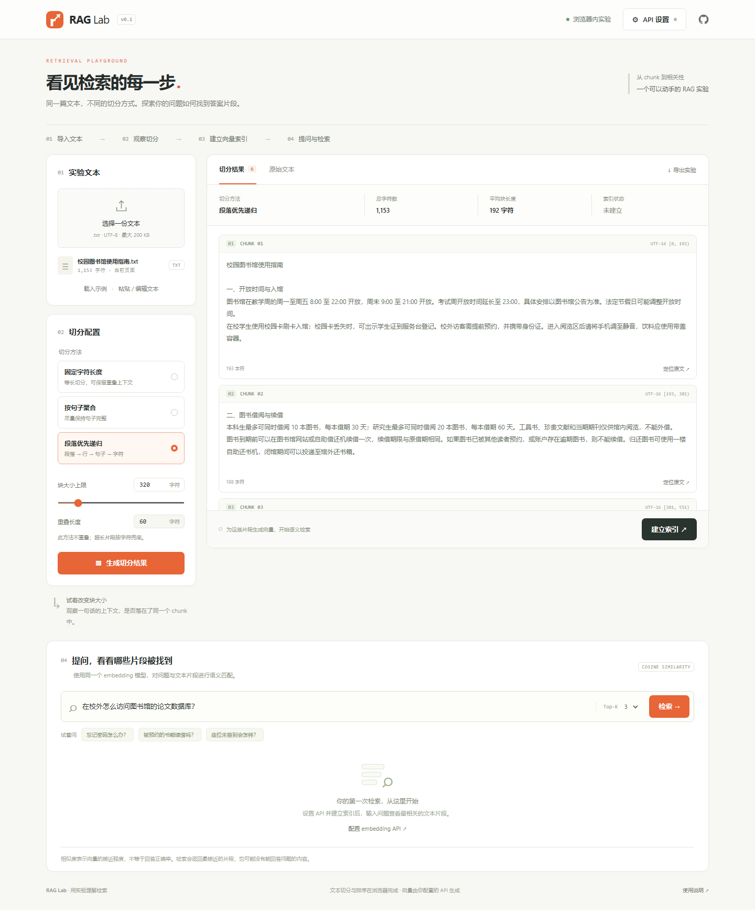

# RAG Lab · 检索实验台

一个用于学习 RAG 检索过程的静态网页：导入文本，比较切分方式，通过用户自己的 embedding API 建立向量索引，并观察问题命中的文本片段。

**第一版包含检索阶段，不包含大模型回答生成。** 没有后端、向量数据库或运行时框架依赖。GitHub Pages 提供网页；浏览器负责切分和相似度排序；模型服务负责向量化。



## 本地运行

安装 Node.js 22 或更高版本，在项目目录运行：

```sh
npm start
```

浏览器打开 <http://127.0.0.1:4173>。不需要先运行 `npm install`。

也可直接用 Python 启动静态服务器：

```sh
python -m http.server 4173 --bind 127.0.0.1 --directory dist
```

不要双击 `index.html` 使用 `file://` 打开，浏览器的 ES 模块需要通过 HTTP 加载。

## GitHub Pages 部署

1. 把项目推送至仓库的 `main` 分支。
2. 打开仓库 **Settings → Pages → Build and deployment → Source**，选择 **GitHub Actions**。
3. 在 **Actions** 中找到 **Validate and deploy RAG Lab**；首次启用 Pages 后如有需要，点击 **Run workflow**。
4. 工作流先执行语法检查和单元测试，通过后发布 `dist/`。

仓库地址：<https://github.com/L1ke40oz/rag_comparison_experiment>。
标准 Pages 地址为 <https://l1ke40oz.github.io/rag_comparison_experiment/>；只有成功部署后此地址才可访问。静态资源使用相对路径，可在仓库子路径下运行。

工作流依据 [GitHub Pages 官方说明](https://docs.github.com/en/pages/getting-started-with-github-pages/using-custom-workflows-with-github-pages) 配置。

## 实验步骤

1. 使用内置的虚构校园图书馆指南，或上传 UTF-8 `.txt`，也可粘贴文本。
2. 选择切分方法，调整块大小。查看 chunk，点击“定位原文”观察上下文边界。
3. 打开 **API 设置**，填写 Base URL、API Key 和 embedding 模型 ID。测试连接会发送一条示例文本。
4. 点击 **建立索引**，把当前全部 chunk 发送给配置的 embedding 服务。进度按已完成的批次更新。
5. 输入问题，选择 Top-K，查看按余弦相似度排序的结果。
6. 导出实验 JSON。修改切分策略，重新建立索引，再用相同问题检索，以便比较。

切分结果不需要 API Key 就能体验。实际向量检索需要你自己的有效模型服务配置，项目不内置公共密钥或伪造检索结果。

## API 兼容范围

第一版支持 OpenAI 兼容的文本 embedding 接口：

```text
POST {Base URL}/embeddings
Authorization: Bearer {用户的 API Key}
Content-Type: application/json

{"model":"模型 ID","input":["文本一","文本二"],"encoding_format":"float"}
```

响应需包含 `data` 数组，各项为 `{index, embedding}`。项目按 `index` 恢复输入顺序，并检查数量、维度、有限数值和非零向量。模型必须支持数组输入及浮点输出；默认每批 8 个 chunk，可改为 1–32。请求超时为 45 秒。出现限流时不会自动重复请求，请稍后再试。

预设 OpenRouter 地址 `https://openrouter.ai/api/v1`，模型 ID `liquid/lfm-2.5-embedding-350m:free`，仅作为免费服务示例。价格、额度、可用性、数据使用政策和语言表现以服务商为准；模型也可以替换为你的其他 embedding 模型。

- [OpenRouter embedding 文档](https://openrouter.ai/docs/api/api-reference/embeddings/create-embeddings)
- [预设模型页面](https://openrouter.ai/liquid/lfm-2.5-embedding-350m%3Afree/providers)

模型的文本 token 上限与字符上限不同。较大的 chunk 可能被接口拒绝或被服务端截断；本项目不在客户端静默截断文本。需要 query/document 前缀、不同 `input_type`、特殊鉴权或特殊请求格式的模型，暂不在通用兼容范围。

### 为什么有些 API 在 Python 中可用，在网页中不可用？

浏览器执行跨域限制。API 必须允许页面来源，并处理带 `Authorization`、`Content-Type` 请求头的预检及真实响应。前端不能自行修复服务端 CORS，也不能用 `no-cors` 读取向量响应。可以选择允许浏览器调用的服务，或以后增加自己管理的转发后端。不要把自己的 Key 发送给不信任的公共代理。

网络故障与 CORS 故障在 JavaScript 中可能都是请求失败，因此页面提示“可能是网络、CORS 或重定向问题”，不会把所有网络错误都认定为 CORS。

## 切分方法

| 方法         | 行为                                                         | 重叠                 |
| ------------ | ------------------------------------------------------------ | -------------------- |
| 固定字符长度 | 以固定步长切分，尾块可短于上限                               | 支持；必须小于块大小 |
| 按句子聚合   | 按中英文句末符号拆分，再聚合到不超过上限；超长句子按字符切分 | 无                   |
| 段落优先递归 | 按空行、换行、句末符号、字符递归拆分，再聚合                 | 无                   |

大小按 Unicode code point 计数，emoji 不会因 UTF-16 的两个代理单元而被拆开。所有方法保留原文空格和换行。`start`、`end` 使用 UTF-16 偏移且 `end` 不包含，保证 `text.slice(start,end)` 能恢复 chunk，界面也据此定位。

这里是规则切分，没有用模型判断语义边界。句末规则是简化实现，不完整处理英文缩写、全部标点组合等语言现象。

## 索引与检索

文档片段与问题由同一个模型向量化，向量归一化后通过点积计算余弦相似度。全部向量存于浏览器内存，检索复杂度为 `O(chunk 数量 × 向量维度)`，适合小规模教学实验。

同一索引可以重复提问。修改文本、切分参数、Base URL、API Key 或模型 ID 会清除旧索引及结果；新配置需要重新切分或索引。异步请求在配置改变后会取消，过时响应不会覆盖当前状态。

**高相似度不等于检索正确。** 系统总会返回最近的 Top-K，没有相关证据时也可能返回不能回答问题的片段。第一版没有标注集、Recall@K 或其他自动质量评估。

## 数据与密钥

- Key 仅保留在当前页面内存及输入框中，不使用 localStorage、sessionStorage、Cookie 或持久化数据库；刷新后需重填。
- Key 只放在向用户配置地址发送的 `Authorization` 请求头中，不写入 URL、日志、源码或实验导出。请求不跟随重定向。
- 文档片段、测试文本和问题会发送给用户选择的模型服务；服务商的数据政策由用户自行选择。
- 文档及向量在当前页面内存中，刷新后丢失。下载的实验 JSON 包含原文，请自行保管。
- 用户提供的 Key 在浏览器中可被页面脚本访问；密码框仅遮挡显示，不是加密保管。项目没有第三方分析脚本、远程字体或 CDN 脚本。
- 输入文本通过文本节点渲染，避免把文档内容当作 HTML 执行。

## 范围与限制

单文件最大 200 KB；文本最多 50,000 字符；块大小 50–2000 字符；最多 1000 个 chunk。推荐先使用短文本和电脑浏览器。仅支持 UTF-8 `.txt`，暂不包含 PDF、多文档持久知识库、用户系统、rerank、回答生成或自动 A/B 评测。

## 代码导览与验证

```text
dist/
  index.html   页面结构
  style.css    响应式样式
  app.js       事件、页面状态、异步取消、文件导入、实验导出
  core.js      三种切分算法、向量归一化、余弦排序
  api.js       API 地址校验、批量请求、响应检查
  sample.js    示例文本
tests/        使用 Node 内置 test runner 的核心测试
tools/        本地静态服务器
.github/      测试与 GitHub Pages 发布工作流
```

```sh
npm run check
npm test
```

测试覆盖 Unicode、原文位置、无丢失切分、重叠边界、相似度排序、响应顺序、异常响应、批次顺序和请求取消。没有真实 Key 的自动化测试不能证明服务商的真实账号权限与模型可用性。

可选的浏览器流程验证（需另开终端运行 `npm start`）：

```sh
npm install --no-save --package-lock=false playwright
npx playwright install chromium
node tools/browser-check.mjs
```

浏览器脚本使用模拟 API，不消耗真实模型额度。它验证上传、切分、连接测试、索引、排序、过时请求取消、导出与移动布局，截图写入被 Git 忽略的 `artifacts/`。Windows 上若有 Edge 则优先使用 Edge；其他环境使用 Playwright 的 Chromium。可通过 `RAG_LAB_URL` 环境变量检查其他部署地址。[首版验证记录](docs/validation.md)列明了已验证行为及限制。

建议学习顺序：先读 `core.js` 理解切分和向量排序，再读 `api.js` 理解请求与响应，最后读 `app.js` 理解界面状态。可以自行编写一组有答案出处的问题，记录不同块大小下的命中位置和上下文完整性，再扩展为带标注的检索评估。
